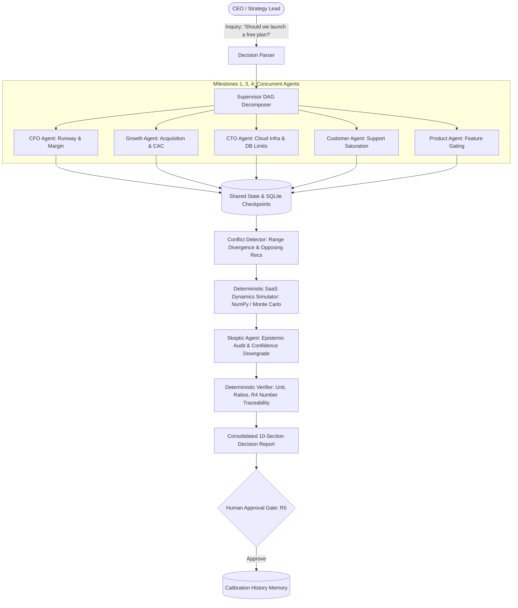

# VentureTwin 🚀
### SwarmFlow: Multi-Agent Task Coordination Engine for SaaS Decision Stress-Testing

[](https://fastapi.tiangolo.com)
[](https://www.python.org/)
[](https://react.dev/)
[](https://docs.pydantic.dev/)
[]()
[](https://opensource.org/licenses/MIT)

> **Hackathon Problem Statement:** SwarmFlow: Multi-Agent Task Coordination Engine  
> **Pitch Persona:** Finance, RevOps, or Strategy leads at Series A/B SaaS companies stress-testing pricing & packaging decisions before board meetings.  
> **Pitch Line:** *"An orchestration engine where agents disagree, conflicts are resolved by simulation instead of voting, no number comes from an LLM, and the system survives an agent failure mid-run."*

---

## 🌟 The 6 Core Differentiators

1. **LLMs Never Output Numbers (Hard Rule R2):** Agents output qualitative claims and structured assumption ranges (`low`, `base`, `high`). All financial outcomes, MRR forecasts, runway, and churn figures are computed by a deterministic Python simulator (`NumPy`, `SciPy`, Monte Carlo).
2. **Simulation-Based Conflict Resolution (Hard Rule R3):** When agents disagree (e.g., CFO warns of margin destruction vs. Growth projects acquisition scale), conflicts are detected and resolved by running both sides through the SaaS dynamics simulator—never by arbitrary voting or LLM preference.
3. **Live Chaos & Fault Recovery (Hard Rule R1 & M7):** Mid-run chaos injection (timeout, unhandled exception, corrupt schema). The supervisor detects faults via heartbeats/validators, activates exponential backoff retry or reassigns to degraded fallback, resuming from SQLite checkpoints without losing completed tasks.
4. **Assumption Ledger & Provenance (Hard Rule R4):** Every assumption traces back to a verified provenance tag (`verified_data`, `external_research`, `simulated_estimate`, `ai_assumption`).
5. **Sensitivity Analysis & Flip-Points:** Tornado sensitivity rankings and plain-language threshold conditions (e.g. *"Strategy B beats Strategy C only if free-to-paid conversion stays above 1.85%"*).
6. **Decision Memory & Calibration:** Decision records persist upon human approval, tracking predicted vs. actual outcomes on seeded calibration datasets.

---

## 🏗 System Architecture



---

## 📋 The 9 Hackathon Milestones: Implementation Status

| Milestone | Implementation Details | Status |
|---|---|---|
| **1. Agent Role Design** | 6 specialized agents (CFO, Growth, CTO, Customer, Product, Skeptic) with distinct objectives, system prompts, deterministic company lookup tools, and Pydantic `Finding` schemas. Agent registry includes extensible placeholders (`Ops`, `Market`, `Risk`). | `[MVP-REAL]` |
| **2. Task Decomposition Engine** | Natural language decision parser converting queries to `Decision` models; autonomous decomposition into 10-node task DAG with cycle detection and dependency validation. | `[MVP-REAL]` |
| **3. Supervisor Architecture** | Asynchronous topological task dispatcher executing parallel root tasks concurrently (verified <0.05s spread) with dependency barriers. | `[MVP-REAL]` |
| **4. Agent Communication Protocol** | Structured typed protocol where agents exchange validated `Finding` objects containing assumption bounds and evidence citations. Malformed outputs are rejected. | `[MVP-REAL]` |
| **5. Shared State Management** | Unified `WorkflowState` persisted after each task via SQLite checkpoint store. Supports resuming interrupted runs without redoing completed tasks. | `[MVP-REAL]` |
| **6. Conflict Detection & Resolution** | 4-part detector (opposing recommendations, non-overlapping assumption ranges, missing evidence, blocked dependencies); simulation-based resolver computing MRR/runway delta and flip-point threshold. | `[MVP-REAL]` |
| **7. Failure Detection & Recovery** | Chaos injection hook (timeout, unhandled exception, schema corruption); supervisor catches faults, applies exponential backoff retry, and falls back to degraded mode while completing the run. | `[MVP-REAL]` |
| **8. Workflow Verification** | Skeptic challenges aggressive assumptions and downgrades confidence; 5 deterministic checks verify units, ratios, and ensure 100% of report numbers trace to simulator runs (catching fabricated numbers). | `[MVP-REAL]` |
| **9. Final Output Generation** | 10-section consolidated decision report (JSON + Markdown), Tornado sensitivity chart, scenario table (Strategies A, B, C), and interactive React frontend. | `[MVP-REAL]` |

---

## 🏷 What is Real vs. What is Mocked / Seeded

- **Implemented Real (`[MVP-REAL]`):**
  - Full multi-agent orchestration, async DAG dispatcher, event bus streaming.
  - Deterministic 24-month SaaS dynamics simulator (`NumPy`, Monte Carlo distributions, OAT Tornado sensitivity, Flip-point search).
  - Rule-based conflict detection and dual-simulation parametric resolution.
  - Live failure injection (`POST /inject-failure`) and backoff / degraded recovery.
  - Deterministic numerical verification checks catching fabricated numbers.
  - Complete FastAPI REST API + SSE streaming.
  - Full React + TypeScript + Tailwind UI (Console, Report, Calibration, Company Graph).
- **Seeded / Simulated (`[MVP-MOCK]`):**
  - Fictional B2B SaaS dataset ("NimbusDesk", Series A, $144k MRR, 12.6mo runway) in `data/synthetic_company.json`.
  - 4 historical decisions with predicted vs. actual outcomes in `data/seeded_decisions.json`.
  - LLM wrapper runs in deterministic offline mock mode by default for 100% repeatable, lightning-fast test execution.

---

## 🚀 Quickstart & Verification

### 1. Prerequisites
- Python 3.11+
- Node.js 18+ and npm (optional for frontend development; pre-built production UI is bundled directly in the backend!)

### 2. Environment Setup
```bash
# 1. Clone repository
git clone https://github.com/YASHK-arch/Citadel-engine.git
cd Citadel-engine

# 2. Setup virtual environment
python3 -m venv .venv
source .venv/bin/activate
pip install -e .

# 3. Environment configuration
cp .env.example .env
# LLM_MOCK_MODE=true is enabled by default for fast, deterministic offline execution.
```

### 3. Run Test Suite
Execute the comprehensive 46-test unit and integration test suite:
```bash
.venv/bin/pytest tests/ -v
```

### 4. Launch Application
Launch the unified FastAPI server (serves both API and the interactive React frontend):
```bash
.venv/bin/uvicorn api.app:app --reload --port 8000
```
Open your browser at:
- **Interactive Web App:** `http://localhost:8000/`
- **Swagger API Docs:** `http://localhost:8000/docs`

---

## 🎬 Demo Walkthrough

Follow the 3-minute hackathon judge demo script in [docs/DEMO_SCRIPT.md](file:///Users/omrajput/Desktop/Projects/Citadel-engine/docs/DEMO_SCRIPT.md):
1. **Decision Console:** Inspect NimbusDesk metrics ($144k MRR, 12.6mo runway).
2. **Stress-Test:** Click chip `"Should we launch a free plan?"`.
3. **Watch DAG:** 5 specialist agents run concurrently.
4. **Chaos Injection:** Click `💥 Crash` on CTO agent; watch supervisor detect fault, retry, and recover.
5. **Conflict Resolution:** CFO vs Growth conflict resolved via dual simulation runs.
6. **Report View:** Review Strategy B recommendation, Tornado chart, and Flip-point statement (`> 1.85% conversion`).
7. **Human Approval:** Click `Approve Decision` to persist decision memory into the Calibration screen.
