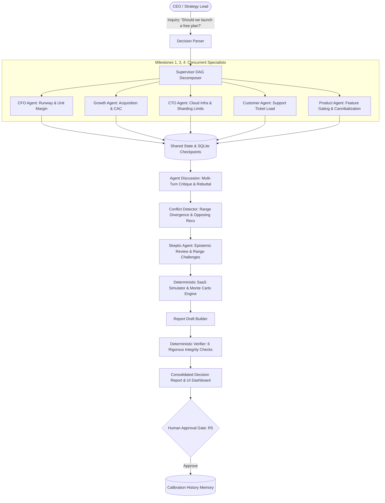

# VentureTwin 🚀
### SwarmFlow: Multi-Agent Task Coordination Engine for SaaS Decision Stress-Testing

[](https://fastapi.tiangolo.com)
[](https://www.python.org/)
[](https://react.dev/)
[](https://docs.pydantic.dev/)
[]()
[](https://github.com/YASHK-arch/NimbusDesk/actions/workflows/ci.yml)
[](https://opensource.org/licenses/MIT)

> **Hackathon Problem Statement:** SwarmFlow: Multi-Agent Task Coordination Engine  
> **Target Persona:** Finance, RevOps, and Executive leadership at SaaS companies stress-testing pricing, packaging, and free-plan decisions prior to board commitment.  
> **Core Tenet:** *"An orchestration engine where agents disagree, conflicts are resolved by simulation and evidence instead of voting, no final number comes from an LLM, and the system survives agent failures mid-run."*

---

## 🌟 The 7 Core Differentiators & Hard Rules

1. **LLMs Never Output Numbers (Hard Rule R2):** Agents output qualitative claims, structured assumptions with validated ranges (`low <= base <= high`), and explicit units. All financial outcomes, MRR forecasts, runway, and churn figures are computed strictly by deterministic Python simulators (`NumPy`, `SciPy`, Monte Carlo).
2. **Simulation-Based Conflict Resolution (Hard Rule R3):** When agents disagree (e.g., CFO models margin erosion vs. Growth projects acquisition lift), conflicts are detected and settled by running both sides through dual simulation matrices—never by arbitrary voting or LLM preference. Resolution texts are generated purely from computed mathematical outputs.
3. **Multi-Turn Agent Communication Protocol (R1 & M4):** Multi-agent structured dialogue featuring explicit message kinds (`proposal`, `critique`, `rebuttal`). The Skeptic agent critiques specialist bounds, and agents post rebuttals before conflict detection.
4. **Order-Independent Reconciliation & Whitelisting:** Assumption reconciliation sorts inputs deterministically by `(agent, assumption_name)`, guaranteeing bit-for-bit identical results regardless of task completion order. Simulated parameters are strictly whitelisted against `SIM_PARAMS` to eliminate LLM hallucinations.
5. **Live Chaos & Fault Recovery (Hard Rule R1 & M7):** Mid-run chaos injection (timeout, unhandled exception, bad output schema). The supervisor catches faults, applies exponential backoff retry, and reassigns persistent failures to `BackupAnalyst` while visibly displaying a degraded banner and capping confidence at Low. Core task failures produce workflow status `failed`.
6. **Probabilistic Monte Carlo Distributions & Bisection Flip-Points:** 250-iteration Monte Carlo sampling with stored seeds and triangular distributions computes win probability (`p_best`) and safety feasibility (`p_feasible`). Flip-points use root bisection down to tolerance $< 1.0$, honestly reporting "Robust to Variation" when no flip point exists in the tested interval.
7. **Six Deterministic Verification Checks (Hard Rule R4):** Automated verifier checks unit consistency, provenance snapshot tie-outs, ratio integrity, monotonic scenario ordering (`conservative <= expected <= optimistic`), non-empty section presence, and 100% report number traceability to simulator runs or snapshot data.

---

## 🏗 System Architecture



---

## 📋 The 9 Hackathon Milestones: Implementation Status

| Milestone | Implementation Details | Status |
|---|---|---|
| **1. Agent Role Design** | 6 specialized agents (CFO, Growth, CTO, Customer, Product, Skeptic) plus `BackupAnalyst` with distinct system prompts, deterministic company lookup tools, and Pydantic `Finding` schemas. | `[MVP-REAL]` |
| **2. Task Decomposition Engine** | Natural language decision parser supporting both `free_plan` and `price_change` decisions; autonomous decomposition into 12-task topological DAG with cycle detection. | `[MVP-REAL]` |
| **3. Supervisor Architecture** | Asynchronous topological task dispatcher executing parallel root tasks concurrently (verified <0.05s spread) with dependency barriers and bounded retries. | `[MVP-REAL]` |
| **4. Agent Communication Protocol** | Structured typed protocol with multi-turn deliberation (`Message` with `proposal`, `critique`, `rebuttal`) recorded in shared state. | `[MVP-REAL]` |
| **5. Shared State Management** | Unified `WorkflowState` persisted after each task via SQLite checkpoint store. Supports resuming interrupted runs without redoing finished work. | `[MVP-REAL]` |
| **6. Conflict Detection & Resolution** | 4-part detector (opposing recommendations, non-overlapping assumption ranges, missing evidence, blocked dependencies); simulation-based resolver computing MRR/runway delta, verdict evaluation (`decision_relevant` vs `immaterial`), and honest `unresolved_material` marking. | `[MVP-REAL]` |
| **7. Failure Detection & Recovery** | Chaos injection hook (timeout, unhandled exception, bad output); supervisor catches faults, applies exponential backoff retry, and reassigns persistent failures to `BackupAnalyst` while visibly displaying a degraded banner and capping confidence at Low. Core failures yield workflow status `failed`. | `[MVP-REAL]` |
| **8. Workflow Verification** | Skeptic challenges aggressive assumptions before simulation; 6 deterministic checks verify units, snapshot tie-outs, ratios, monotonic scenario ordering, required sections, and 100% draft number traceability with bounded loop-back on failure. | `[MVP-REAL]` |
| **9. Final Output Generation** | 10-section consolidated decision report (JSON + Markdown), Outcome Ranges (Monte Carlo distributions), Tornado sensitivity ranking, Bisection Flip-point analysis, and interactive React frontend. | `[MVP-REAL]` |

---

## 🏷 What is Real vs. What is Mocked / Seeded

- **Implemented Real (`[MVP-REAL]`):**
  - Full multi-agent orchestration, async DAG dispatcher, event bus streaming.
  - Polymorphic `SimulatorAdapter` unifying deterministic 24-month SaaS dynamics (`NumPy`, Monte Carlo distributions, OAT Tornado sensitivity, Bisection flip-point search).
  - Price-change simulation model with tier-specific price elasticity mechanics.
  - Multi-turn deliberation protocol with data-driven Skeptic critique and structured agent rebuttals.
  - Rule-based conflict detection and simulation-based resolution (no voting, signed deltas, converged consensus verification).
  - Live failure injection (`POST /api/decisions/{id}/inject-failure`) and backoff / degraded recovery with `BackupAnalyst`.
  - Non-vacuous numerical verification checks with `NumberRegistry` tracing every report figure to source.
  - Complete FastAPI REST API + SSE streaming.
  - Full React + TypeScript + Tailwind UI (Console, Report, Calibration, Company Graph).
- **Seeded / Simulated (`[MVP-MOCK]`):**
  - Fictional B2B SaaS dataset ("NimbusDesk", Series A, $89.7k MRR, 12.6mo runway) in `data/synthetic_company.json`.
  - Illustrative SaaS benchmarks in `data/benchmarks.json` (`"illustrative": true, "sourced": false`).
  - 4 historical decisions with predicted vs. actual outcomes in `data/seeded_decisions.json`.
  - Calibration history memory is seeded illustrative data (`[MVP-MOCK]`).

---

## 🤖 LLM Modes (mock / real / record / replay)

VentureTwin supports four explicit LLM execution modes configured via `LLM_MODE` in `.env`:

1. **`mock` (Default):** Generates deterministic domain-specialist findings offline with zero API keys and lightning-fast CI runtime.
2. **`real`:** Executes live LLM queries against configured frontier models (`GEMINI_MODEL`, `OPENAI_MODEL`, or `ANTHROPIC_MODEL`). Requires explicit model identification and API key; missing keys or models immediately raise `ConfigurationError` (no silent fallback).
3. **`record`:** Makes live API calls while capturing sanitized request/response cassettes to disk for repeatable evaluation.
4. **`replay`:** Reads committed test cassettes offline with bit-for-bit fidelity and zero network dependency.

> **Evaluation Note:** For judge evaluation and live demonstrations, the primary demo should be run in **`replay`** or **`real`** mode, not `mock`.

---

## 🧬 What is Synthetic

All company data, financial figures, customer counts, and benchmarks used in VentureTwin are explicitly synthetic:
- **NimbusDesk Dataset (`data/synthetic_company.json`):** A realistic but fictional Series A B2B ticketing SaaS company with 1,447 paying accounts across Starter ($49/mo), Growth ($199/mo), and Enterprise ($999/mo) plans.
- **Industry Benchmarks (`data/benchmarks.json`):** Illustrative median conversion rates (2.2%), cannibalization estimates (8.0%), support ticket loads (0.04 tickets/user/mo), and starter price elasticity (0.65). All benchmark objects carry `"illustrative": true, "sourced": false` metadata.
- **Synthetic Badge (Hard Rule R6 / R7):** Every report and UI screen displays a prominent `Synthetic Data` badge. No claims of real external enterprise customer data or validated live third-party integrations are made.

---

## ⚠️ Known Limitations & Planned Extensions

- **`[MVP-MOCK]` Calibration Ledger:** The Calibration screen currently presents seeded historical decision records (`data/seeded_decisions.json`). Production bi-directional sync to external accounting/ERP ledgers (NetSuite, QuickBooks) is planned.
- **`[MVP-REAL]` Decision Models:** Fully implemented and validated for `free_plan` (freemium & usage caps) and `price_change` (tier elasticity & contraction). Additional strategic archetypes (sales quota restructuring, international multi-currency rollout) are planned.
- **Hard Rule R5 (Human-in-the-Loop):** The platform strictly produces advisory stress-tests with traceable simulation evidence. It never autonomously alters external billing or production configuration without explicit human approval.

---

## 🚀 Quickstart & Verification

### 1. Prerequisites
- Python 3.11+
- Node.js 18+ and npm (optional for frontend development; pre-built production UI is bundled directly in the backend!)

### 2. Environment Setup
```bash
# 1. Clone repository
git clone https://github.com/YASHK-arch/Citadel-engine.git
cd Citadel-engine

# 2. Setup virtual environment
python3 -m venv .venv
source .venv/bin/activate
pip install -e ".[dev]"

# 3. Environment configuration
cp .env.example .env
# LLM_MODE=mock is enabled by default for fast, deterministic offline execution.
```

### 3. Run Test Suite
Execute the comprehensive 94-test unit and integration test suite:
```bash
.venv/bin/pytest tests/ -v
```

Execute **The One-Minute Acceptance Test Suite**:
```bash
.venv/bin/pytest tests/test_acceptance.py -v
```

### 4. Launch Application
Launch the unified FastAPI server (serves both the API and the interactive React Simulation Workspace frontend):
```bash
.venv/bin/uvicorn api.app:app --reload --port 8000
```
Open your browser at:
- **Interactive Web App (Primary Endpoint):** `http://localhost:8000/`
- **Swagger API Docs:** `http://localhost:8000/docs`

> **Note on Endpoints & Distribution:**
> - **Unified Production Endpoint:** `http://localhost:8000/` is the single official application endpoint. The pre-built production frontend is bundled in `ui/dist` and served directly by FastAPI. Zero Node.js installation is required to run the full application!
> - **Frontend Development (HMR):** For live frontend development with Vite hot-reloading, run `cd ui && npm run dev` on `http://localhost:5173/`, which proxies all API calls to `http://localhost:8000`. Both endpoints serve the identical VentureTwin Simulation Workspace.

---

## 🎬 Demo Walkthrough

Follow the 3-minute hackathon judge demo script in [docs/DEMO_SCRIPT.md](docs/DEMO_SCRIPT.md):
1. **Decision Console:** Inspect NimbusDesk metrics ($144k MRR, 12.6mo runway).
2. **Stress-Test:** Click chip `"Should we launch a free plan?"`.
3. **Watch DAG:** 5 specialist agents run concurrently.
4. **Deliberation:** Observe multi-turn critique and rebuttal between Skeptic, Growth, and CFO.
5. **Chaos Injection:** Click `💥 Crash` on CTO agent; watch supervisor detect fault, retry, and recover.
6. **Conflict Resolution:** CFO vs Growth conflict resolved via dual simulation runs.
7. **Report View:** Review dynamic strategy recommendation, Outcome Ranges (Monte Carlo distributions), Tornado chart, and Bisection Flip-point.
8. **Human Approval:** Click `Approve Decision` to persist decision memory into the Calibration screen.
