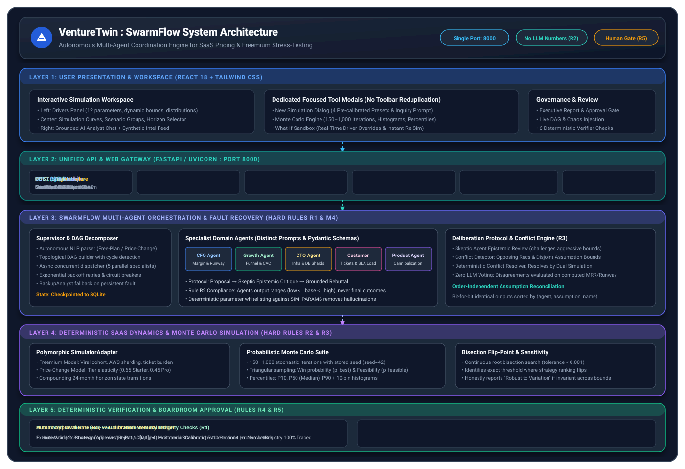
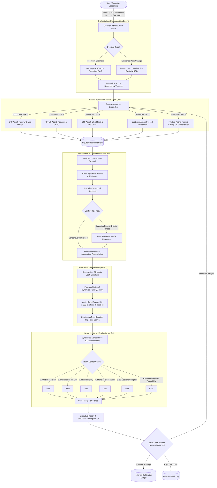
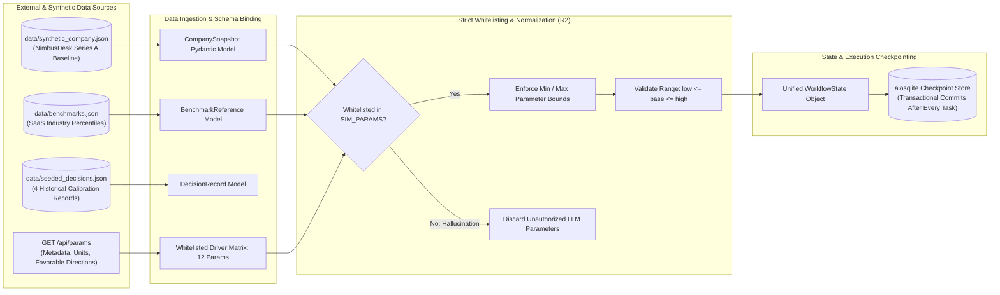
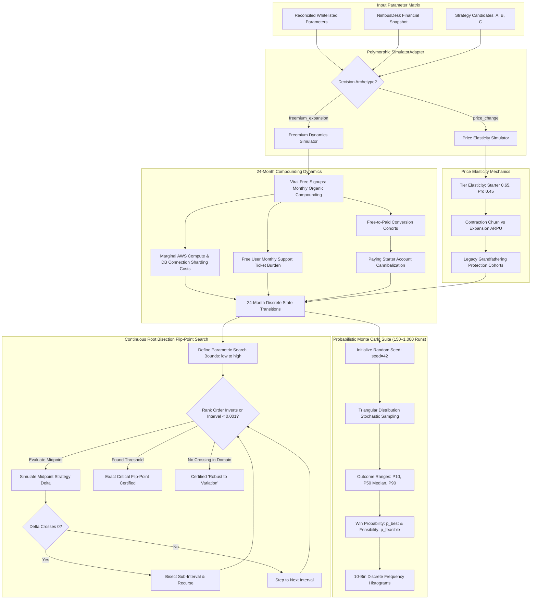

# VentureTwin: Complete System Architecture & Operational Workflows

> **Platform:** VentureTwin (SwarmFlow Multi-Agent Task Coordination Engine)  
> **Repository:** [https://github.com/YASHK-arch/Citadel-engine](https://github.com/YASHK-arch/Citadel-engine)  
> **Unified Primary Endpoint:** `http://localhost:8000/` (FastAPI ASGI + Compiled React 18 SPA)

---

## 🏛 Visual System Architecture



---

## 🌟 The 5 Non-Negotiable Hard Rules

| Hard Rule | Engine Principle | Concrete Implementation |
|---|---|---|
| **R1: True Multi-Agent Nodes** | Autonomous specialist agents; no single prompt roleplaying multiple personas. | 5 independent specialist agents (CFO, Growth, CTO, Customer, Product) + Skeptic & BackupAnalyst with distinct Pydantic `Finding` schemas. |
| **R2: Zero LLM Generated Numbers** | LLMs formulate qualitative hypotheses and structured ranges (`low <= base <= high`). | All financial outcomes, MRR, cash runway, and cloud infrastructure costs are computed deterministically by NumPy / SciPy SaaS simulators. |
| **R3: Simulation Conflict Resolution** | Disagreements are settled by running parallel simulations against both sides, never by LLM voting. | 4-part conflict detector triggers dual simulation runs; resolution narratives are derived purely from computed mathematical deltas. |
| **R4: 100% Number Traceability** | Zero fabricated numbers or hallucinations allowed in final deliverables. | Automated Verifier runs 6 checks with `NumberRegistry` tracing every report integer and float back to a simulation run or snapshot datum. |
| **R5: Human-in-the-Loop Gate** | The platform never executes external business actions autonomously. | Boardroom approval gate (`Approve`, `Request Changes`, `Reject`) requires human authorization and commits memory to the Calibration Ledger. |

---

## 📊 1. End-to-End System Workflow Flowchart

This flowchart illustrates how a strategic question moves through intake, multi-agent decomposition, parallel execution, simulation, verification, and human sign-off:



---

## 📥 2. Data Ingestion & Parameter Lifecycle Flowchart

How company ground truth, benchmarks, seeded calibration history, and live parameter overrides are ingested, normalized, and strictly whitelisted:



---

## 🤖 3. Multi-Agent Deliberation & Chaos Resilience Flowchart

How specialist agents debate, how Skeptic epistemic reviews occur, and how mid-run chaos faults are detected, retried, and recovered without workflow termination:

```mermaid
flowchart TD
    subgraph TaskDispatch ["Topological Task Dispatch"]
        Supervisor[Supervisor Dispatcher] -->|Spawns Task Node| TaskExec[Execute Specialist Agent]
    end

    subgraph ChaosFaultHook ["Chaos Injection Hook (Rule R1 / M7)"]
        TaskExec --> FaultCheck{Injected Chaos Fault?}
        FaultCheck -->|Timeout: 5,000ms| FaultTrigger[Simulate Network / Model Latency]
        FaultCheck -->|Unhandled Exception| CrashTrigger[Raise Execution Error]
        FaultCheck -->|Corrupted Schema| BadSchemaTrigger[Inject Malformed JSON Payload]
        FaultCheck -->|Normal Run| GenerateFinding[Generate Pydantic Finding Schema]
        
        FaultTrigger & CrashTrigger & BadSchemaTrigger --> RecoveryEngine[Supervisor Recovery Engine]
    end

    subgraph RecoveryStrategy ["Resilience & Bounded Fallback Protocol"]
        RecoveryEngine --> AttemptCounter{Attempt <= Max Retries (3)?}
        AttemptCounter -->|Yes| Backoff[Exponential Backoff: 0.1s, 0.2s, 0.4s]
        Backoff --> TaskExec
        AttemptCounter -->|No: Persistent Fault| BackupFallback[Reassign Task to BackupAnalyst]
        BackupFallback --> DegradedTag[Tag State as Degraded & Cap Confidence at Low]
        DegradedTag --> GenerateFinding
    end

    subgraph DeliberationProtocol ["Multi-Turn Communication Protocol (M4)"]
        GenerateFinding --> PostProposal[Agent Posts Proposal to Shared State]
        PostProposal --> SkepticCritique[Skeptic Agent Epistemic Review]
        SkepticCritique --> CritiqueCheck{Bounds Aggressive or Evidence Weak?}
        CritiqueCheck -->|Yes| IssueChallenge[Post Critique & Downgrade Confidence]
        CritiqueCheck -->|No| AcceptProposal[Endorse Proposed Bounds]
        IssueChallenge --> RebuttalMsg[Original Agent Posts Grounded Rebuttal]
        RebuttalMsg & AcceptProposal --> DeliberationLog[(Deliberation Message Stream)]
    end

    subgraph ConflictResolutionEngine ["Simulation-Driven Conflict Resolution (R3)"]
        DeliberationLog --> ConflictDetector{Contradictory Recs or Disjoint Ranges?}
        ConflictDetector -->|Yes: Disagreement Flagged| RunDualSim[Execute Dual Simulation Run Matrix]
        RunDualSim --> ComputeDelta[Compute Delta: Month 12 MRR & Runway Impact]
        ComputeDelta --> VerdictEval{Impact Material (>5% MRR or >2mo Runway)?}
        VerdictEval -->|Yes| DecisionRelevant[Mark Decision-Relevant & Keep Distinct Strategies]
        VerdictEval -->|No| Immaterial[Mark Immaterial & Reconcile to Conservative Bound]
        ConflictDetector -->|No: Full Agreement| Converged[Verified Consensus Reached]
    end
```

---

## 📈 4. SaaS Dynamics, Monte Carlo & Bisection Flip-Point Flowchart

How parameters enter the mathematical engine, compound across 24 forward months, execute stochastic Monte Carlo stress-testing, and undergo continuous root bisection search:



---

## 💬 5. Grounded AI Analyst Chat Feature Flowchart

How the AI Analyst chat feature in the right-hand panel receives user queries, performs report grounding, extracts verified data, and eliminates hallucinations:

```mermaid
flowchart TD
    UserQuery([User Types Question in Assistant Panel]) --> SubmitAsk[POST /api/decisions/{id}/ask]

    subgraph Gateway ["FastAPI Gateway & Report Retrieval"]
        SubmitAsk --> LoadReport{Decision & Report Exist?}
        LoadReport -->|No| PromptSim[Return Advisory: 'Please run simulation first']
        LoadReport -->|Yes| ExtractReport[Load Verified Report Sections from Shared State / SQLite]
    end

    subgraph IntentClassifier ["Semantic Intent Classification"]
        ExtractReport --> MatchIntent{User Inquiry Intent?}
        MatchIntent -->|Recommendation / Which / Should| RecIntent[Recommendation & Confidence Intent]
        MatchIntent -->|Flip / Threshold / Break-even| FlipIntent[Conversion Flip-Point Intent]
        MatchIntent -->|Runway / Cash / Burn| RunwayIntent[Cash Runway & Safety Floor Intent]
        MatchIntent -->|Risk / Cannibalization / Threat| RiskIntent[Risk & Active Mitigations Intent]
        MatchIntent -->|General Inquiry / Comparison| GeneralIntent[Scenario Summary Intent]
    end

    subgraph GroundedExtraction ["Report-Grounded Fact Extraction (Rule R4)"]
        RecIntent --> ExtRec[Extract: primary_strategy, confidence, confidence_score]
        FlipIntent --> ExtFlip[Extract: flip_point.threshold_display, variable, narrative]
        RunwayIntent --> ExtRunway[Extract: scenario_table.runway_months_12_expected, safety_floor: 10.0mo]
        RiskIntent --> ExtRisk[Extract: risks category, description, mitigations]
        GeneralIntent --> ExtGeneral[Extract: Month 12 MRR expected, conservative, optimistic]
    end

    subgraph Synthesis ["Deterministic Answer Formulation"]
        ExtRec & ExtFlip & ExtRunway & ExtRisk & ExtGeneral --> SynthesizeMsg[Synthesize Grounded Answer with Exact Numerical Citations]
        SynthesizeMsg --> PackageJSON[Package Response: grounded_in_report: True]
    end

    PackageJSON --> Browser[Deliver to UI Message Bubble in Assistant Panel]
    Browser --> RenderUI[Render Instant Grounded Response with Provenance]
```

---

## ⚡ 6. Live What-If Re-Simulation Flowchart

How dragging sliders in the Drivers Panel or What-If Sandbox triggers debounced live re-simulation without corrupting or mutating the stored executive report:

```mermaid
flowchart LR
    subgraph UI_Action ["User Workspace Interaction"]
        SliderChange[User Drags Parameter Slider<br/>(e.g. Conversion 2.5% → 3.8%)] --> Debounce[Debounce Timer: 500ms]
    end

    subgraph API_Call ["Live What-If Request"]
        Debounce --> PostResim[POST /api/decisions/{id}/resimulate<br/>Body: { overrides: { param_name: value } }]
    end

    subgraph Execution ["Stateless Sandbox Execution"]
        PostResim --> CloneState[Clone Reconciled Parameters without mutating Stored Report]
        CloneState --> ApplyOverrides[Apply Whitelisted User Overrides]
        ApplyOverrides --> ReSimRun[Execute 12-Month Multi-Scenario Simulation Run]
        ReSimRun --> ReRank[Re-Rank Strategy Feasibility & Net Contribution]
        ReRank --> ReSampleMC[Fast 150-Iteration Monte Carlo Sampling]
    end

    subgraph ReactiveUI ["Reactive UI Updates"]
        ReRank & ReSampleMC --> ReturnJSON[Return Updated Ranking, Scenarios & Outcome Ranges]
        ReturnJSON --> UpdateCurves[Re-render Simulation Curves on Recharts Canvas]
        ReturnJSON --> UpdateCards[Update Scenario Probability Cards: Pessimistic / Realistic / Optimistic]
        ReturnJSON --> HighlightDelta[Display Live Net Contribution & Runway Delta]
    end
```

---

## 🛡️ 7. The Six Deterministic Verification Checks Flowchart

Detailed breakdown of the automated verifier pipeline running before any report is finalized:

```mermaid
flowchart TD
    ReportDraft[Report Builder Completes Initial Draft] --> VerifierEngine[Deterministic Verifier Pipeline: Rule R4]

    subgraph Check1 ["Check 1: Unit Consistency"]
        VerifierEngine --> C1{Check 1}
        C1 -->|Validate| U1[Currencies = USD, Headcount = Int, Ratios in Domain]
        U1 -->|Pass| C2
        U1 -->|Fail| Abort1[Abort: Unit Inconsistency Detected]
    end

    subgraph Check2 ["Check 2: Ground-Truth Snapshot Tie-Out"]
        C2{Check 2} -->|Validate| U2[Baseline MRR ($89.7k) and Cash ($1.13M) match NimbusDesk data]
        U2 -->|Pass| C3
        U2 -->|Fail| Abort2[Abort: Ground Truth Mismatch]
    end

    subgraph Check3 ["Check 3: Ratio Integrity"]
        C3{Check 3} -->|Validate| U3[Gross Margin & Churn strictly bounded in [0.0, 1.0]]
        U3 -->|Pass| C4
        U3 -->|Fail| Abort3[Abort: Mathematical Domain Out of Bounds]
    end

    subgraph Check4 ["Check 4: Monotonic Scenario Ordering"]
        C4{Check 4} -->|Validate| U4[Conservative MRR <= Expected MRR <= Optimistic MRR]
        U4 -->|Pass| C5
        U4 -->|Fail| Abort4[Abort: Non-Monotonic Scenarios Detected]
    end

    subgraph Check5 ["Check 5: Mandatory 10 Sections Complete"]
        C5{Check 5} -->|Validate| U5[All 10 required sections non-empty and formatted]
        U5 -->|Pass| C6
        U5 -->|Fail| Abort5[Abort: Missing Mandatory Sections]
    end

    subgraph Check6 ["Check 6: NumberRegistry 100% Traceability"]
        C6{Check 6} -->|Validate| U6[Every integer & float traced to Simulator or Snapshot registry]
        U6 -->|Pass| FinalPass[100% Traceability Verified: ZERO Hallucinations]
        U6 -->|Fail| Abort6[Abort: Untraced or Hallucinated Number Detected]
    end

    FinalPass --> EmitReady[Emit report_ready SSE Event to Frontend]
```

---

## 📁 8. Project File Map & Cross-References

| Component | Key Source Files | Description |
|---|---|---|
| **Web & API Gateway** | [`api/app.py`](file:///c:/Users/yashk/Desktop/SPECIAL%20PROJECTS/Citadel-engine/api/app.py) | Unified FastAPI ASGI server, SSE streaming, static SPA mounting. |
| **Workspace Frontend** | [`ui/src/components/SimulationWorkspace.tsx`](file:///c:/Users/yashk/Desktop/SPECIAL%20PROJECTS/Citadel-engine/ui/src/components/SimulationWorkspace.tsx) | Complete 3-column workspace with live drivers and chart rendering. |
| **Focused Modals** | [`ui/src/components/workspace/WorkspaceModal.tsx`](file:///c:/Users/yashk/Desktop/SPECIAL%20PROJECTS/Citadel-engine/ui/src/components/workspace/WorkspaceModal.tsx) | Dedicated light-themed modals (New Simulation, Report, DAG, Monte Carlo, What-If). |
| **Multi-Agent Supervisor** | [`orchestration/supervisor.py`](file:///c:/Users/yashk/Desktop/SPECIAL%20PROJECTS/Citadel-engine/orchestration/supervisor.py) | Async concurrent task dispatcher, cycle detection, fault recovery. |
| **Specialist Agents** | [`agents/`](file:///c:/Users/yashk/Desktop/SPECIAL%20PROJECTS/Citadel-engine/agents/) | CFO, Growth, CTO, Customer, Product, Skeptic, and BackupAnalyst implementations. |
| **SaaS Simulation Model** | [`simulation/saas_model.py`](file:///c:/Users/yashk/Desktop/SPECIAL%20PROJECTS/Citadel-engine/simulation/saas_model.py) | 24-month discrete state transitions for freemium SaaS dynamics. |
| **Price Elasticity Model** | [`simulation/price_model.py`](file:///c:/Users/yashk/Desktop/SPECIAL%20PROJECTS/Citadel-engine/simulation/price_model.py) | Tier elasticity, ACV expansion, and contraction churn mechanics. |
| **Monte Carlo Engine** | [`simulation/monte_carlo.py`](file:///c:/Users/yashk/Desktop/SPECIAL%20PROJECTS/Citadel-engine/simulation/monte_carlo.py) | 150–1,000 stochastic sampling suite, triangular distributions, histograms. |
| **Bisection Flip-Point** | [`simulation/flip_point.py`](file:///c:/Users/yashk/Desktop/SPECIAL%20PROJECTS/Citadel-engine/simulation/flip_point.py) | Continuous root bisection search for strategy inversion threshold. |
| **Deterministic Verifier** | [`verification/verifier.py`](file:///c:/Users/yashk/Desktop/SPECIAL%20PROJECTS/Citadel-engine/verification/verifier.py) | 6 rigorous mathematical checks and NumberRegistry provenance auditor. |
| **SQLite Checkpoints** | [`orchestration/checkpoints.py`](file:///c:/Users/yashk/Desktop/SPECIAL%20PROJECTS/Citadel-engine/orchestration/checkpoints.py) | Transactional persistence store for resuming interrupted workflows. |
| **Synthetic Dataset** | [`data/synthetic_company.json`](file:///c:/Users/yashk/Desktop/SPECIAL%20PROJECTS/Citadel-engine/data/synthetic_company.json) | Ground-truth Series A B2B ticketing SaaS company ("NimbusDesk"). |
