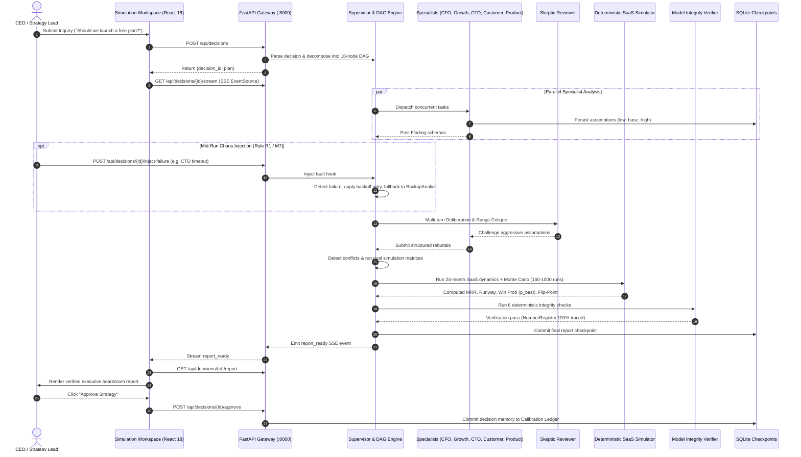

# VentureTwin: Comprehensive Architecture & System Design

> **Platform:** VentureTwin (SwarmFlow Multi-Agent Task Coordination Engine)  
> **Repository:** [https://github.com/YASHK-arch/Citadel-engine](https://github.com/YASHK-arch/Citadel-engine)  
> **Primary Endpoint:** `http://localhost:8000/` (FastAPI ASGI + Compiled React SPA)

---

## 🏛 System Architecture Diagram

---

## 🌟 The 5 Non-Negotiable Hard Rules

| Hard Rule | Engine Principle | Implementation in VentureTwin |
|---|---|---|
| **R1: Distinct Agent Personas** | True multi-agent coordination; no single LLM prompt roleplaying multiple personas. | 5 independent specialist agents (CFO, Growth, CTO, Customer, Product) + Skeptic & BackupAnalyst with distinct Pydantic `Finding` schemas. |
| **R2: Zero LLM Generated Numbers** | LLMs propose qualitative claims and structured assumption ranges (`low <= base <= high`). | All financial forecasts, MRR, cash runway, and cloud server costs are computed deterministically by NumPy / SciPy SaaS simulators. |
| **R3: Simulation Conflict Resolution** | Disagreements between agents are settled via dual simulation matrices, never by voting or LLM preference. | 4-part conflict detector triggers dual simulation runs; resolution narratives are derived purely from computed mathematical deltas. |
| **R4: 100% Number Traceability** | Zero fabricated numbers or hallucinations allowed in final deliverables. | Automated Verifier runs 6 checks with `NumberRegistry` tracing every report integer and float back to a simulation run or snapshot datum. |
| **R5: Human-in-the-Loop Gate** | The platform never executes external business actions autonomously. | Boardroom approval gate (`Approve`, `Request Changes`, `Reject`) requires human authorization and commits memory to the Calibration Ledger. |

---

## 🔄 End-to-End Execution Sequence

---

## 🧩 Architectural Layers & Components

### 1. Presentation & Workspace Layer (`ui/`)
- **Technology:** React 18, TypeScript, Tailwind CSS, Recharts.
- **Single Production Endpoint:** Built bundle in `ui/dist` is served directly by FastAPI at `http://localhost:8000/`.
- **Simulation Workspace:**
  - **Left Panel:** 12 whitelisted simulation drivers with real-time range bounds, units, and probability distributions.
  - **Center Panel:** Multi-scenario projection curves (Pessimistic, Realistic, Optimistic) with interactive horizon selection (FY2024–FY2027).
  - **Right Panel:** Grounded AI Assistant and Synthetic Intel Feed.
- **Single-Purpose Focused Modals:**
  - **New Simulation:** Pre-calibrated SaaS decision inquiry cards and custom inquiry prompt.
  - **Executive Report & Approval Gate:** Boardroom memo, strategy matrix, flip-point card, risk ledger, and human approval controls.
  - **Live DAG & Chaos Injection:** Real-time topological task status, fault injection panel (timeout, exception, corrupted schema), and event log.
  - **Monte Carlo Engine:** 150–1,000 stochastic sampling iterations, random seed control, win probabilities ($P_{\text{best}}$), and 10-bin histograms.
  - **What-If Sandbox:** Live parameter override sliders with debounced real-time re-simulation (`POST /api/decisions/{id}/resimulate`).
  - **Bisection Break-Even & Flip-Point:** Root bisection search threshold analysis with safety floor runway guarantee.
  - **Model Validator:** Six automated deterministic verification checks.
  - **Company Baseline & Calibration:** NimbusDesk ground truth metrics and historical decision ledger.

### 2. Unified Web & API Gateway (`api/app.py`)
- **Technology:** FastAPI, Starlette, Uvicorn, Python 3.11+.
- **Endpoints:**
  - `POST /api/decisions`: Decision intake, NLP parsing, DAG initialization.
  - `GET /api/decisions/{id}/stream`: Real-time Server-Sent Events (SSE) event bus.
  - `POST /api/decisions/{id}/inject-failure`: Mid-run chaos injection for testing resilience.
  - `GET /api/decisions/{id}/report`: Returns 10-section verified decision report.
  - `POST /api/decisions/{id}/resimulate`: Real-time what-if parameter re-simulation.
  - `POST /api/decisions/{id}/ask`: AI Assistant Q&A grounded in simulation evidence.
  - `POST /api/decisions/{id}/approve`: Human authorization gate committing decision memory.
  - `GET /api/params`: Dynamic parameter bounds, units, and favorable directions.
  - `GET /api/company`: NimbusDesk financial and operational snapshot.
  - `GET /api/history`: Calibration memory ledger.
  - `GET /api/graph`: Operational dependency topology.
  - `GET /`: Serves pre-built React production SPA bundle from `ui/dist`.

### 3. SwarmFlow Orchestration Engine (`orchestration/`)
- **Supervisor (`orchestration/supervisor.py`):** Asynchronous topological task dispatcher executing parallel root tasks concurrently.
- **Task Decomposition (`orchestration/decomposition.py`):** Decomposes strategic queries into a validated 10-to-12 task DAG with cycle detection.
- **Event Bus (`orchestration/event_bus.py`):** In-memory asynchronous publish/subscribe broker powering SSE streams.
- **Checkpoint Store (`orchestration/checkpoints.py`):** SQLite persistence layer saving workflow snapshots after each task node.
- **Failure Recovery (`orchestration/recovery.py`):** Mid-run chaos detection with bounded exponential backoff and `BackupAnalyst` fallback.

### 4. Specialist Multi-Agent Layer (`agents/`)
- **CFO Agent:** Runway burn, gross margin impact, and financial safety floors.
- **Growth Agent:** Acquisition funnels, monthly organic signups, and conversion velocity.
- **CTO Agent:** Server sharding, DB connection limits, and marginal AWS compute cost.
- **Customer Support Agent:** Ticket generation rates and SLA staffing requirements.
- **Product Agent:** Feature gating, tier boundaries, and paid user cannibalization.
- **Skeptic Agent:** Epistemic review challenging overly optimistic parameter ranges before simulation.
- **BackupAnalyst:** Resilient fallback agent activated when a primary specialist suffers unrecoverable faults.

### 5. Deterministic SaaS Simulation Engine (`simulation/`)
- **Polymorphic SimulatorAdapter:** Unifies 24-month SaaS dynamics:
  - `simulation/saas_model.py`: Freemium cohort conversions, marginal compute costs, ticket loads, and cannibalization.
  - `simulation/price_model.py`: Tier-specific price elasticity, grandfathering mechanics, and contraction churn.
- **Conflict Resolution (`simulation/conflict_resolver.py`):** Evaluates agent disagreements using dual simulation runs rather than voting.
- **Monte Carlo Suite (`simulation/monte_carlo.py`):** 150–1,000 stochastic sampling runs with triangular distributions and stored seeds.
- **Bisection Flip-Point Search (`simulation/flip_point.py`):** Numerical root bisection search finding exact strategy inversion thresholds.

### 6. Deterministic Verification & Governance Layer (`verification/`)
- **Six Deterministic Checks (`verification/verifier.py`):**
  1. Unit Consistency Verification (currencies, ratios, headcount, time dimensions).
  2. Ground-Truth Provenance Tie-Out (all baseline figures tie to company snapshot).
  3. Ratio Integrity Verification (gross margins and churn rates bounded in $[0, 1]$).
  4. Monotonic Scenario Ordering ($Conservative \le Expected \le Optimistic$).
  5. Mandatory Section Completeness (all 10 required report sections populated).
  6. NumberRegistry 100% Traceability (guarantees zero hallucinated numbers).
- **Report Builder (`reporting/report_builder.py`):** Synthesizes verified simulation evidence into JSON and board-ready Markdown memos.
- **Calibration Store (`data/`):** Audits historical decision variance between forecasts and actual accounting outcomes.
