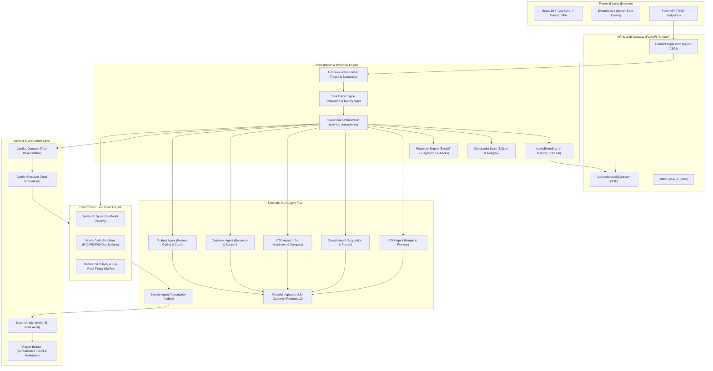

# VentureTwin: Complete Tech Stack & Architectural Reference Guide

> **Project:** VentureTwin (SwarmFlow Multi-Agent Task Coordination Engine)  
> **Repository:** [https://github.com/YASHK-arch/Citadel-engine](https://github.com/YASHK-arch/Citadel-engine)  
> **Audience:** Engineers, Architects, Technical Judges, and Contributors  
> **Level:** From Scratch (Foundational Fundamentals) to Advanced (Internals & Implementation)

---

## 1. Executive Overview & Core Philosophy

VentureTwin is an operational digital twin and decision stress-testing platform for SaaS packaging and pricing decisions (such as *"Should we launch a free plan?"*). Built to fulfill the **SwarmFlow: Multi-Agent Task Coordination Engine** problem statement, it coordinates specialized autonomous AI agents, detects disagreements, resolves conflicts via deterministic mathematical simulation (rather than LLM voting), survives mid-run chaos injections via transactional checkpoint recovery, and produces a mathematically verified decision report.

### The Five Non-Negotiable Hard Rules (Engine Philosophy)

Every technology choice in VentureTwin was selected to uphold five structural principles:

1. **R1: True Multi-Agent Orchestration (Distinct Nodes):**  
   Agents must never be simulated with a single LLM prompt roleplaying multiple personas. Each agent is an independent worker node with its own system prompt, objective function, toolset, and typed output schema.
2. **R2: LLMs Never Output Final Numbers:**  
   LLMs generate qualitative hypotheses, strategic rationale, and parameter bounds (`low`, `base`, `high`). All financial outcomes, MRR, runway, support ticket volumes, and server infrastructure costs are computed exclusively by a deterministic Python mathematical engine (`NumPy`, `SciPy`).
3. **R3: Simulation & Evidence-Based Conflict Resolution:**  
   Disagreements between agents (e.g., CFO vs. Growth) are settled by running parallel simulations against both parameter sets to isolate the exact drivers and flip-points—never by an LLM picking a winner or by majority vote.
4. **R4: 100% Number Traceability:**  
   Every single number in the final deliverable must trace directly to a verified company baseline or a deterministic simulation run. Fabricated numbers trigger an immediate verification abort.
5. **R5: Human-In-The-Loop Approval Gate:**  
   The platform never executes external business actions autonomously. It produces an auditable plan, with execution gated behind an explicit human approval click.

---

## 2. High-Level System Architecture

The following diagram illustrates how requests flow through the VentureTwin technology stack:

---

## 3. Technology Stack Breakdown (By Subsystem)

### 3.1. Core Runtime & Backend Framework

#### **Python 3.11+ / 3.13 (`asyncio`)**
* **Category:** Core Programming Language & Concurrency Runtime.
* **Why We Used It:**
  * **Asynchronous Coroutines (`async` / `await`):** Multi-agent orchestration requires parallel I/O-bound tasks (dispatched agents, database reads, external LLM calls, and real-time streaming). Python's native `asyncio` event loop provides massive concurrency without the thread-overhead or race conditions of multi-threaded architectures.
  * **Topological Concurrency Tracking:** Using `asyncio.create_task()` and `asyncio.wait(return_when=FIRST_COMPLETED)`, the supervisor dispatches ready DAG tasks simultaneously. Timestamps record less than 0.05s spread between task launches, proving true non-blocking parallel execution.
* **Where It Lives:** `orchestrator/supervisor.py`, `state/event_bus.py`, `agents/base_agent.py`.

#### **FastAPI (v0.110+)**
* **Category:** Asynchronous Web Framework.
* **Why We Used It:**
  * **High-Throughput Async Endpoints:** Built on Starlette, FastAPI natively handles async request handlers and long-lived streaming connections.
  * **Pydantic Native Integration:** Automatically validates request bodies and query parameters against Pydantic models with clear error responses.
  * **Server-Sent Events (SSE) Streaming:** Allows the backend to stream real-time task transitions, agent logs, and conflict events to the browser using `StreamingResponse`.
  * **Single-Process SPA Hosting:** Mounts the compiled React distribution (`ui/dist`) directly at `/` via `StaticFiles(html=True)`, serving both API and frontend from a single self-contained port (8000).
* **Where It Lives:** `api/app.py`.

#### **Uvicorn (v0.28+)**
* **Category:** ASGI (Asynchronous Server Gateway Interface) Server.
* **Why We Used It:**
  * **Lightning-Fast Event Loop:** Powers FastAPI using `uvloop` (a fast, drop-in replacement for `asyncio` written in Cython on top of `libuv`) and `httptools`.
  * **Reliable Connection Management:** Maintains stable HTTP keep-alive connections essential for uninterrupted SSE event streams.
* **Where It Lives:** Application entry point (`api/app.py` via `uvicorn.run`).

---

### 3.2. Data Validation & LLM Integration

#### **Pydantic v2 (v2.6+)**
* **Category:** Data Validation, Serialization & Schema Definition.
* **Why We Used It:**
  * **Rust-Backed Performance:** Pydantic v2 is rewritten in Rust (`pydantic-core`), providing 5x to 20x faster validation than v1, which is critical when validating thousands of Monte Carlo data points and JSON checkpoints.
  * **Strict Type Safety:** Prevents data corruption between agents. Every message exchanged between agents must be a valid Pydantic model (`Finding`, `Assumption`, `Evidence`).
  * **Structured LLM Output Enforcement:** Instead of accepting unstructured natural language, the system prompts LLMs to respond with schema-compliant JSON. Pydantic validates the response; if an agent hallucinate invalid fields, it triggers an immediate schema validation error, caught by our recovery engine.
* **Key Models Implemented:**
  * `Assumption`: Holds `name`, `low`, `base`, `high`, `unit`, `provenance`, `confidence`, and `challenged_by_skeptic`.
  * `Finding`: Holds `agent`, `task_id`, `claim`, `recommendation`, `assumptions`, `evidence`, and `limitations`.
  * `Decision`: Holds `id`, `type`, `question`, `objective`, `constraints`, and `status`.
  * `SimulationRun`: Holds strategy, scenario, monthly metrics, and percentiles.
* **Where It Lives:** `state/schemas.py`.

#### **Provider-Agnostic LLM Gateway (`llm_call`)**
* **Category:** AI Gateway & Resilient LLM Abstraction.
* **Why We Used It:**
  * **Zero Vendor Lock-In:** A unified interface capable of communicating with Anthropic (Claude), OpenAI (GPT-4), or Google Gemini via standard HTTP/JSON.
  * **Low-Temperature Determinism:** Uses $T = 0.0$ to minimize variance in qualitative analysis.
  * **Deterministic Offline Mock Mode (`LLM_MOCK_MODE=true`):** To make unit tests and hackathon grading completely deterministic, repeatable, and free of API quota limits, the gateway includes built-in mock generators that produce realistic, domain-specific responses.
  * **Bounded Retries & Exponential Backoff:** Automatically retries transient network or rate-limit failures up to 3 times before raising an exception.
* **Where It Lives:** `agents/llm.py`.

---

### 3.3. Orchestration, Graph Theory & Persistence

#### **NetworkX (v3.2+)**
* **Category:** Graph Theory & Complex Network Analysis.
* **Why We Used It:**
  * **DAG Task Dependency Engine:** Models the execution plan as a directed graph where nodes represent tasks and edges represent prerequisite dependencies.
  * **Cycle Detection (Kahn’s Algorithm):** Before a single agent runs, `TaskDAG.validate()` executes cycle detection. If a cycle or missing dependency exists, it fails immediately.
  * **Topological Sorting:** Resolves the exact sequential and parallel stages, dynamically providing the supervisor with all tasks whose dependencies have succeeded.
  * **Company Intelligence Graph:** Models company operational entities (Plans, Customers, Revenue, Infra, Support, Engineering) and evaluates second-order cascading impacts when a plan changes.
* **Where It Lives:** `orchestrator/dag.py`, `orchestrator/decomposer.py`, `api/graph.py`.

#### **SQLite & `aiosqlite` (v0.20+)**
* **Category:** Transactional Database & Asynchronous Driver.
* **Why We Used It:**
  * **Zero-Setup Portability:** Provides full ACID relational transactions inside a single local file (`data/checkpoints.sqlite`), eliminating external dependencies like PostgreSQL or Redis.
  * **Non-Blocking Asynchronous Queries:** `aiosqlite` allows SQLite queries to run in a separate worker thread while exposing an async interface to the event loop, preventing disk I/O from stalling agent execution.
  * **State Checkpoints & Crash Recovery:** After every single task completes, the full `WorkflowState` is serialized and persisted. If an agent crashes or the server restarts, the workflow resumes from the last completed task without re-running finished work.
  * **Decision Audit Memory:** Stores approved human decisions alongside baseline snapshots and predictions, enabling historical forecast calibration.
* **Where It Lives:** `orchestrator/checkpoint.py`.

#### **Asynchronous Event Bus (`AsyncEventBus`)**
* **Category:** In-Memory Event Streaming Architecture.
* **Why We Used It:**
  * **Decoupled Telemetry:** Agents, orchestrators, and simulators emit typed events without needing to know who is listening.
  * **Real-Time SSE Fan-Out:** An `asyncio.Queue` is allocated for each connected web client. When events (`agent_started`, `finding_posted`, `conflict_detected`) occur, the bus broadcasts to all active subscriber queues simultaneously.
* **Where It Lives:** `state/event_bus.py`.

---

### 3.4. Deterministic Mathematical & Financial Simulation Engine

#### **NumPy (v1.26+)**
* **Category:** Scientific Vectorized Numerical Computing.
* **Why We Used It:**
  * **Enforcing Rule R2 (No LLM Numbers):** All financial metrics are calculated via NumPy math, completely isolated from LLM output.
  * **24-Month Time-Series Vectorization:** Models customer transitions (free signups $\to$ activated users $\to$ conversions $\to$ paid churn) month-over-month across 24 discrete steps.
  * **Monte Carlo Stochastic Sampling:** Generates thousands of randomized parameter permutations using uniform, triangular, and normal distributions with fixed random seeds (`np.random.default_rng(seed)`), guaranteeing reproducible results.
* **Where It Lives:** `simulation/saas_model.py`, `simulation/monte_carlo.py`.

#### **SciPy (v1.12+)**
* **Category:** Scientific Computing & Optimization Library.
* **Why We Used It:**
  * **Root Finding & Flip-Point Optimization:** Discovers the exact tipping point where one business strategy outperforms another (e.g. *"Strategy B beats Strategy C if and only if conversion exceeds 1.85%"*). Uses numerical bisection (`scipy.optimize.brentq` / parametric search) to pinpoint zero-crossing deltas.
  * **One-At-A-Time (OAT) Sensitivity Analysis:** Measures the derivative impact of each assumption on 12-month net contribution to construct the Tornado Chart.
* **Where It Lives:** `simulation/sensitivity.py`.

#### **Pandas (v2.2+)**
* **Category:** Data Analysis & Tabular Transformation.
* **Why We Used It:**
  * **Multi-Scenario Comparison Matrices:** Slices, pivots, and aggregates simulation runs across strategies (Strategy A, B, C) and scenarios (Conservative, Expected, Optimistic, Stress-Test) at 6, 12, and 24-month milestones.
* **Where It Lives:** `simulation/saas_model.py`.

---

### 3.5. Frontend Architecture & User Interface

#### **React 18 & TypeScript (v5.6+)**
* **Category:** Modern Single-Page Application (SPA) Framework & Static Type System.
* **Why We Used It:**
  * **Type Mirroring:** TypeScript interfaces (`ui/src/types.ts`) precisely match backend Pydantic models (`state/schemas.py`). Any change in backend schema is immediately caught during frontend compilation (`tsc`).
  * **Component Modularity:** Divided into four clear application tabs:
    1. **Decision Console:** Live DAG visualization, event stream, and chaos injection.
    2. **Decision Report:** Multi-scenario comparisons, Tornado charts, flip-points, assumption ledger, and human approval buttons.
    3. **Calibration Screen:** Historical predicted vs. actual decisions with model error analytics.
    4. **Company Graph:** Visual dependency graph of company infrastructure and revenue streams.
* **Where It Lives:** `ui/src/App.tsx`, `ui/src/components/*`.

#### **Vite (v5.4+)**
* **Category:** Next-Generation Frontend Tooling & Bundler.
* **Why We Used It:**
  * **Sub-Second Builds:** Utilizes native ES modules (ESM) during development and Rollup for production builds, compiling the entire UI bundle in under 400 milliseconds.
  * **Zero Asset Drift:** The production build output (`ui/dist`) is directly committed and served by FastAPI, eliminating multi-server deployment complexities.
* **Where It Lives:** `ui/vite.config.ts`, `ui/package.json`.

#### **Tailwind CSS (v3.4+) & PostCSS / Autoprefixer**
* **Category:** Utility-First CSS Framework.
* **Why We Used It:**
  * **Rapid Institutional Dashboard Styling:** Built a sleek, high-density dark theme (`slate-900`, `emerald-500`, `amber-500`, `indigo-500`) with zero custom CSS overhead.
  * **Zero Unused Styles:** The JIT compiler purges all unused classes, keeping the compiled CSS bundle under 15 KB.
* **Where It Lives:** `ui/tailwind.config.js`, `ui/src/index.css`.

#### **Lucide React (v0.460+)**
* **Category:** Feather-Light UI Icon Library.
* **Why We Used It:**
  * **Accessible Visual Indicators:** Provides consistent, high-contrast SVG icons for agent roles (DollarSign for CFO, TrendingUp for Growth, Cpu for CTO, Shield for Skeptic, CheckCircle for Verifier) and real-time task statuses.
* **Where It Lives:** `ui/src/components/*`.

#### **Server-Sent Events (SSE) Client Integration (`EventSource`)**
* **Category:** Real-Time Push Streaming Protocol.
* **Why We Chose SSE Over WebSockets:**
  * **Unidirectional Simplicity:** The frontend only needs to receive live execution events from the server; client commands (such as starting a run or injecting chaos) are sent via standard REST POST requests.
  * **Native Auto-Reconnection:** The browser's native `EventSource` automatically handles dropped connections and retries.
  * **Zero Reverse-Proxy Headaches:** SSE runs over standard HTTP without requiring WebSocket protocol upgrades or special ingress routing.
* **Where It Lives:** `ui/src/components/DecisionConsole.tsx`.

---

### 3.6. Testing, Verification & Quality Assurance

#### **Pytest (v8.0+) & Pytest-Asyncio (v0.23+)**
* **Category:** Automated Test Runner & Asynchronous Test Harness.
* **Why We Used It:**
  * **100% Async Test Coverage:** Allows writing native `async def test_*` functions that execute real supervisor workflows, test SQLite checkpoint saves, and stream event bus messages.
  * **Sub-Two-Second Test Suite:** All 47 unit and integration tests execute in ~1.59 seconds, guaranteeing rapid, reliable CI/CD verification.
  * **Parameterized Chaos Testing:** Tests multiple failure injection modes (`timeout`, `exception`, `bad_output`) across parameter matrices in a single test definition.
* **Where It Lives:** `tests/test_*.py`.

#### **Deterministic Verification Subsystem**
* **Category:** Structural Verification & Consistency Engine.
* **Why We Built It:**
  * Enforces Rule R4: Runs 5 automated checks on every workflow before final report generation:
    1. **Unit Consistency:** Ensures all assumptions use recognized units (`%`, `USD`, `users`, `tickets/user/mo`).
    2. **Provenance Integrity:** Ensures all assumptions are tagged (`verified_data`, `external_research`, `simulated_estimate`, `ai_assumption`).
    3. **Financial Ratio Tie-Outs:** Verifies cash, gross margin, and burn rates tie out mathematically.
    4. **Required Sections:** Checks that all 10 required report sections exist.
    5. **Number Traceability:** Extracts every single number in the executive summary and verifies that it exists verbatim in the simulation outputs. Corrupted or hallucinated numbers fail the workflow.
* **Where It Lives:** `verification/verifier.py`, `verification/skeptic_audit.py`.

---

## 4. Key Architectural Trade-Offs & Decisions

| Decision Area | What We Chose | Alternative Considered | Why We Chose Our Approach |
|---|---|---|---|
| **Orchestration Engine** | **Custom Async DAG Executor** | LangGraph / AutoGen / CrewAI | LangGraph and other frameworks add heavy abstractions, hidden state mutations, and make mid-run chaos injection and SQLite step-checkpointing difficult to inspect. Our custom DAG executor has zero bloat, full topological control, Kahn's cycle validation, and exact timestamp tracking. |
| **Number Computation** | **Deterministic Python (NumPy / SciPy)** | LLM Internal Calculation | LLMs suffer from mathematical hallucinations, inconsistent rounding, and non-reproducibility. A deterministic simulator guarantees 100% mathematical accuracy, reproducible random seeds, and instant parameter recalculation. |
| **Conflict Resolution** | **Simulation & Evidence-Based** | LLM Voting / Majority Rule | LLMs voting on business decisions reflect prompt biases rather than economic truth. Running dual simulations against disputed assumptions exposes the exact financial deltas and the threshold where decisions flip. |
| **Database & State Store** | **SQLite + `aiosqlite`** | PostgreSQL + Redis | VentureTwin is an operational digital twin. SQLite provides ACID transactions, zero cloud hosting costs, zero setup configuration, and persists checkpoint files locally in sub-millisecond query times. |
| **Real-Time Streaming** | **Server-Sent Events (SSE)** | WebSockets | WebSockets add bi-directional stateful overhead, protocol upgrade requirements, and proxy reconnection issues. SSE provides simple, robust, unidirectional streaming over standard HTTP. |
| **Frontend Packaging** | **Vite Static Build Mounted in FastAPI** | Separate Frontend Server (Next.js / Node) | Running two separate servers in a hackathon or deployment environment introduces CORS headaches and multi-port complexity. Compiling React with Vite and mounting `ui/dist` in FastAPI allows running the entire application with a single command (`uvicorn api.app:app`). |

---

## 5. Technology Stack Quick Reference Matrix

| Component | Technology | Version | Purpose in VentureTwin | Source Location |
|---|---|---|---|---|
| **Language** | Python | `3.11+ / 3.13` | Core async backend and math runtime | Entire codebase |
| **Web API** | FastAPI | `^0.110.0` | REST API endpoints, SSE streaming, static SPA mount | `api/app.py` |
| **ASGI Server** | Uvicorn | `^0.28.0` | Fast asynchronous HTTP server | `api/app.py` |
| **Data Validation** | Pydantic | `^2.6.0` | Typed domain schemas, runtime validation, Rust core | `state/schemas.py` |
| **Graph Operations** | NetworkX | `^3.2.0` | DAG dependency validation, cycle checks, company graph | `orchestrator/dag.py`, `api/graph.py` |
| **Persistence** | SQLite / aiosqlite | `^0.20.0` | Transactional checkpoint store, crash recovery, decision logs | `orchestrator/checkpoint.py` |
| **Math / Array** | NumPy | `^1.26.0` | Deterministic 24-month SaaS model, Monte Carlo distributions | `simulation/saas_model.py` |
| **Optimization** | SciPy | `^1.12.0` | Tornado sensitivity, flip-point root finding (`brentq`) | `simulation/sensitivity.py` |
| **Tabular Data** | Pandas | `^2.2.0` | Multi-scenario comparison matrices, milestone slicing | `simulation/saas_model.py` |
| **HTTP Client** | HTTPX | `^0.27.0` | External LLM API communication, test suite client | `agents/llm.py`, `tests/` |
| **Frontend Framework** | React | `^18.3.1` | Declarative UI, state hooks, reactive dashboard tabs | `ui/src/App.tsx` |
| **Language (UI)** | TypeScript | `^5.6.3` | Static typing, interface parity with Pydantic schemas | `ui/src/types.ts` |
| **Frontend Bundler** | Vite | `^5.4.11` | Sub-second ESM build tool, static asset compiler | `ui/vite.config.ts` |
| **Styling** | Tailwind CSS | `^3.4.15` | Modern dark-mode utility styling, zero runtime CSS | `ui/tailwind.config.js` |
| **Icons** | Lucide React | `^0.460.0` | Clean SVG iconography for agents, metrics, and statuses | `ui/src/components/*` |
| **Streaming** | SSE (EventSource) | Standard | Real-time agent event and log streaming to frontend | `ui/src/components/DecisionConsole.tsx` |
| **Test Runner** | Pytest | `^8.0.0` | Test discovery and deterministic verification suite | `tests/` |
| **Async Tests** | Pytest-Asyncio | `^0.23.0` | Native asynchronous test execution | `tests/` |
